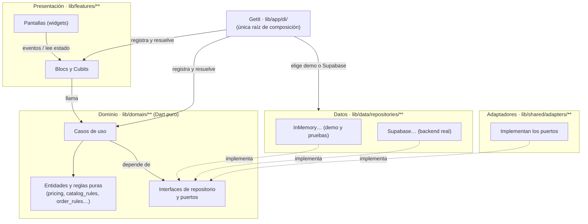
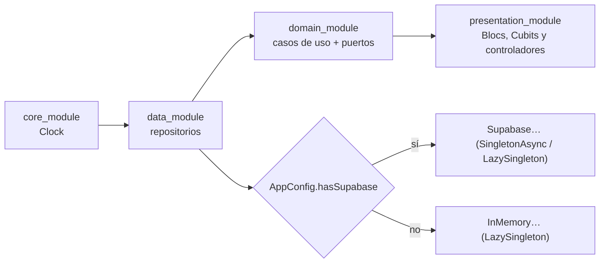
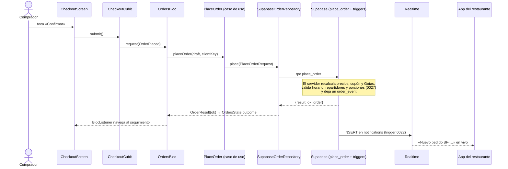
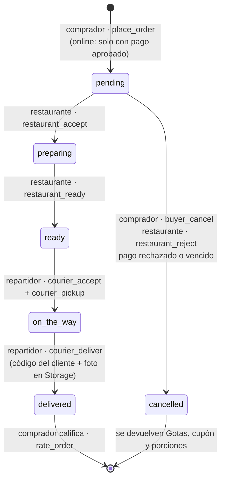
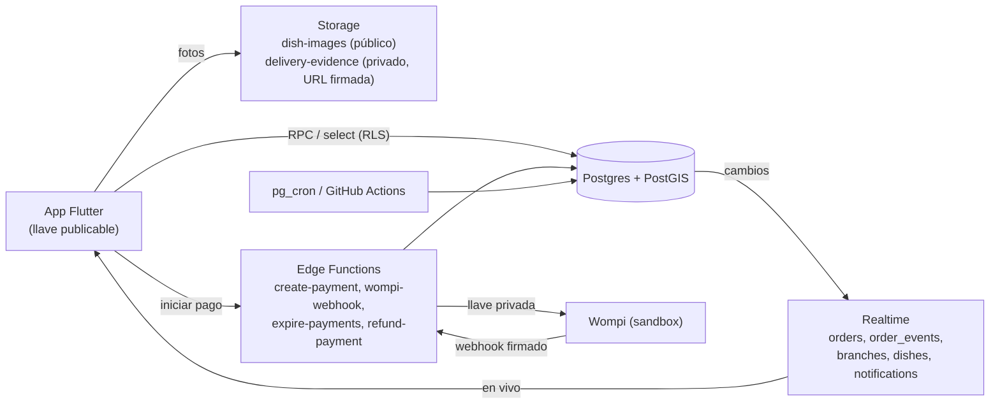

# Arquitectura de Biffy

Biffy es una app Flutter para tres roles (comprador, restaurante y
repartidor) sobre un backend Supabase. El código sigue **Clean Architecture**:
cada capa solo conoce a la de adentro. El estado de las pantallas vive en
**Bloc/Cubit** y todas las piezas se conectan con **GetIt**.

> Los diagramas son Mermaid: GitHub y VS Code (con la extensión de Mermaid)
> los dibujan solos.

---

## 1. Capas y dirección de las dependencias



Las reglas que **no se negocian** (las verifica `test/architecture_test.dart`):

| Regla | Por qué |
|---|---|
| `lib/domain` no importa Flutter, Supabase, GetIt ni otras capas | Las reglas de negocio se prueban sin app ni red. |
| Solo `lib/app/di/` conoce las implementaciones concretas | Cambiar demo ↔ Supabase no toca pantallas. |
| Solo la capa de datos y el módulo de datos importan Supabase | Ningún widget llama a la base directamente. |
| La única decisión de entorno (`AppConfig.hasSupabase`) está en el módulo de datos | Un solo interruptor para toda la app. |
| Sin `provider` ni `AppServices` | Todo sale de GetIt. |

---

## 2. GetIt: qué se registra y cómo

`configureDependencies()` (`lib/app/di/injection.dart`) registra cuatro
módulos en orden. Nada se crea hasta que alguien lo pide.



| Módulo | Qué registra | Ciclo de vida |
|---|---|---|
| `core_module` | `Clock` | `LazySingleton` |
| `data_module` | `AuthRepository`, `CatalogRepository`, `OrderRepository`, `PaymentRepository`, `ProfileRepository`, `NotificationRepository`, `ReviewRepository`, `RewardsRepository`, `MerchantBoxesRepository` (tipados por la interfaz) | `LazySingleton` (los que hidratan caché con Supabase: `SingletonAsync`) |
| `domain_module` | Casos de uso: `OrderUseCases`, `RateOrder`, `GetDeliveryEvidence`, `GetCourierEarnings`, `StartPayment`, `CheckPaymentStatus`, `RetryPayment`, `LoadRewards`, `RedeemReward`, cajas del restaurante. Puertos: `OrderCatalogPort`, `OrderBuyerPort`, `OrderWalletPort`, `OrderNotifier`, `BranchRatingPort`, `ReviewNotifier` | Casos de uso `Factory`; puertos `LazySingleton` |
| `presentation_module` | `OrdersBloc` y `CartCubit` (globales); `PaymentBloc`, `RateOrderCubit`, `DeliveryEvidenceCubit`, `EarningsCubit` (con parámetro); `LoginCubit`, `RegisterCubit`, `UniversityVerificationCubit`, `CheckoutCubit`, `RewardsCubit`, `NotificationsCubit`, `MerchantBoxesCubit` | Globales `LazySingleton`; de pantalla `Factory` / `FactoryParam` |

Una pantalla pide su Cubit así (ejemplo real: foto de evidencia):

```dart
BlocProvider(
  create: (_) => getIt<DeliveryEvidenceCubit>(param1: order.id),
  child: _EvidenceBody(order: order),
)
```

Las pruebas no tienen constructores especiales: hacen `getIt.reset()`,
registran dobles (`FakeOrderRepository`, etc.) y piden las piezas igual que la
app (`test/helpers.dart`).

> **Pendiente de HU-2:** `SessionController`, `CatalogController` y
> `NotificationCenter` siguen siendo `ChangeNotifier`, registrados en GetIt.
> Se están migrando a `AuthBloc`, `CatalogBloc` y `NotificationsCubit`.

---

## 3. Un flujo completo: el comprador confirma su pedido



Si el servidor rechaza, el `result` (por ejemplo `branch_closed` o
`no_portions`) se traduce a español en `lib/domain/order_errors.dart` y la
pantalla lo muestra. Nunca se ve un código crudo.

---

## 4. Ciclo del pedido y quién lo mueve



Con Supabase **el servidor decide**: la app llama al RPC y el estado nuevo
llega en la recarga o por Realtime. En la demo, el repositorio en memoria aplica
las mismas transiciones (`kAllowedTransitions` en `lib/domain/order_rules.dart`).

---

## 5. Backend (Supabase)



| Pieza | Dónde | Qué garantiza |
|---|---|---|
| RLS | `0004`, `0019`, `0022`, `0026` | Cada usuario ve solo lo suyo; los pedidos solo cambian por RPC. |
| `place_order` | `0019` → `0025` → `0026` | Precios, descuentos, cupón, Gotas e idempotencia (`client_key`) en el servidor. |
| Reglas del servidor | `0027_server_guards.sql` | Horario de la sede, repartidores conectados reales y `sold_today` por día (triggers). |
| Avisos | `0022_order_notifications.sql` | La base crea una notificación por destinatario en cada transición; Realtime la entrega. |
| Pagos | `0026_payments.sql` + Edge Functions | El pedido solo llega al restaurante con el pago aprobado; webhook firmado e idempotente. |
| Verificación | `0099_verify.sql` | Falla con un mensaje claro si falta algo; si no, imprime `Biffy OK`. |

---

## 6. Dónde mirar en el código (para la sustentación)

| Tema | Archivo |
|---|---|
| Composición con GetIt | `lib/app/di/injection.dart`, `lib/app/di/modules/*.dart` |
| Bloc global de pedidos | `lib/features/orders/bloc/orders_bloc.dart` |
| Caso de uso de ejemplo | `lib/domain/usecases/orders/place_order.dart` |
| Interfaz de repositorio | `lib/domain/repositories/order_repository.dart` |
| Implementación real | `lib/data/repositories/supabase_order_repository.dart` |
| Implementación demo | `lib/data/repositories/in_memory_order_repository.dart` |
| Regla pura con pruebas | `lib/domain/catalog_rules.dart` ↔ `test/unit/catalog_rules_test.dart` |
| Cubit con `bloc_test` | `lib/features/buyer/tracking/delivery_evidence_cubit.dart` ↔ `test/unit/delivery_evidence_cubit_test.dart` |
| Reglas de arquitectura | `test/architecture_test.dart` |
| Reglas del servidor | `supabase/migrations/0027_server_guards.sql` ↔ `supabase/tests/hu4_reglas_servidor.sql` |
